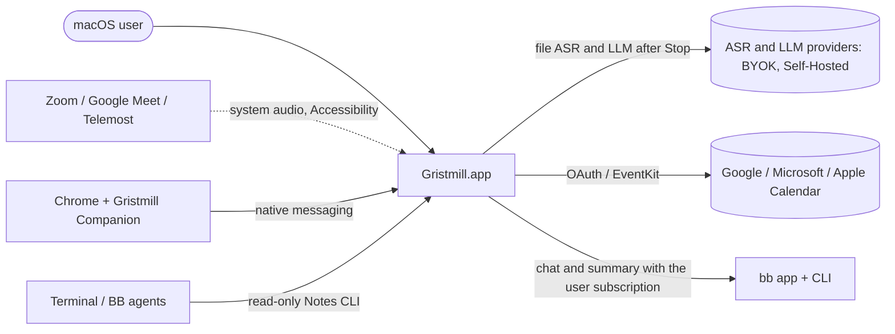

# Architecture overview (C4 levels 1 and 2)

This document is a map, not a contract. Examine the code for details.

## Level 1: System context

Gristmill has no backend.
All data is in the local profile in Electron `userData` (SQLite and managed files).
The application uses the network only for processing, calendars and model downloads.
Capture does not use the network.

## Level 2: Containers

| Container | Code location | Responsibility |
| --- | --- | --- |
| Electron main | `main.ts`, `src/helpers/` | Owns SQLite (`better-sqlite3`), managed paths, Opus writing, the processing worker, provider calls, IPC, calendars, the BB bridge, the Companion server and the CLI bridge |
| Preload | `preload.ts`, `src/preload/` | A narrow typed bridge. The renderer does not get arbitrary file paths |
| Renderer | `src/` (React 19, Vite, HeroUI, Tailwind, zustand) | Notes, chat, settings, recording UI. The AudioWorklet code is in `meetingAudioPipeline.ts`. The capture session is in `meetingRecordingStore.ts` |
| IPC contracts | `src/contracts/` | Typed contracts between main, renderer and worker |
| ONNX worker | `src/workers/onnxWorker.ts` | Local diarization and speaker embeddings |
| Native helpers | `resources/*.swift` | System audio tap and clock probes, microphone and call detection, Zoom Accessibility, EventKit calendar, globe key |
| Local engines | Installed in `userData` at first use | whisper.cpp, llama.cpp, sherpa-onnx. They are not in the app bundle |
| Companion extension | `extension/` | MV3 extension: Google Meet and Telemost adapters, mute, Leave, participants, clock probes |
| Companion native host | An entry in `build:main` | Connects Chrome native messaging to the Unix socket of the profile |
| Notes CLI | `scripts/gristmill-cli.cts` → `~/.local/bin/gristmill` | Read-only access to notes through the CLI bridge |
| Provider registry | `src/services/ai/`, `src/helpers/*Transcription.ts` | A static TypeScript table of providers behind stage contracts |

## Main flows

- Recording and processing: [recording and processing](recording-processing.md), [post-Stop processing](post-stop-processing.md), [audio storage](audio-storage.md).
- Speakers: [speaker evidence](speaker-evidence.md).
- Browser integration: [Companion](companion.md), [Telemost](companion-telemost.md).
- BB route: [BB integration](bb-integration.md).

## Local engine startup

The llama.cpp and Whisper managers own each stop, spawn and readiness operation before it can yield. Identical pending requests share their result. Different model or startup settings requests wait and then check the loaded identity again. Stop invalidates queued starts and waits for their settlement; a new request waits for teardown. Llama context can grow and a smaller request can reuse the loaded context. Whisper captures VAD/thread options for wake rewarming.
