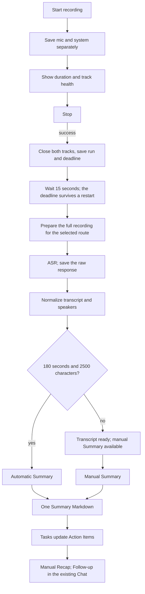

# Recording → Stop → processing

- Decision and alternatives: [ADR-0003](../adr/0003-record-then-process.md).
- Storage of the original tracks: [audio storage](audio-storage.md).
- Schema, paths and run ownership: [recording and processing](recording-processing.md).

Automatic processing after Stop or End call includes all available finished audio parts of the Note.
The `group_id` value does not limit this set.
The parts are sorted by `startedAt`, then by ID.
Main saves this set before ASR.
A new capture cancels the pending processing of the same Note.
Groups describe capture sessions. They do not show if the transcript is complete.
The audio assembly sorts the parts itself.
Old results and BB threads stay.
To get a complete result for a recording that was split before, transcribe it again.

## Pipeline rules

Storage, mute, clock alignment, run creation and provider input formats are in [recording and processing](recording-processing.md).

### Results and Notes projection

- The transcript and the Summary are per-run artifacts.
- `notes.transcript` and `notes.enhanced_content` show the selected run. The manual `note.content` stays separate.
- Source tracks and previous artifacts stay after a retry and after the selection of a different version.

### Speaker naming and Summary thresholds

- Speaker naming runs after the transcript is saved and before the optional Summary. This also applies to the Transcribe button.
- The separate Summary button uses the saved names. It does not run naming again.
- Naming can use the saved Summary route. A user correction wins by revision.
- The first automatic Summary needs a duration of 180 seconds or more and 2,500 transcript characters or more.
- An explicit new transcription makes a new Summary for each non-empty transcript. Previous versions and these thresholds do not apply.
- A manual Summary is available for each ready transcript.

### User name for the microphone

- Settings → Profile and onboarding ask for the user name.
- The name goes into the configuration snapshot and is assigned to microphone turns. An empty name gives "Вы" or "You".
- The design assumes one person at the microphone. Echo and new voice samples are not part of this feature.

### Transcript format for the LLM

- The LLM gets plain text in `<transcript>` tags: `Speaker N: "turn"`.
- The microphone is Speaker 1. Other speakers get labels that are stable in one transcript.
- Names and the audio source are given separately.
- Adjacent turns of one speaker are merged.
- JSON and turn IDs stay internal.
- Naming returns the same labels. The application converts them back to source IDs.
- In BB, the same transcript is not sent again to the saved thread. Accepted names are sent separately.

### Calendar participants

- In the speaker editor, the user can link a name to the email of a calendar participant.
- The name is stored locally in `contacts.learned_name`. It stays after a Google sync and adds candidates for later meetings.
- An automatic link is permitted only for one exact name match. An email without a name needs a user choice.
- Speaker numbers are not used as identity across meetings.

### Summary sections and Follow-up

- The Summary is one Markdown artifact.
- After the Summary is saved, tasks fill the existing `## Action Items` section. Zero tasks remove the section.
- Recap adds or updates `## Recap` in the same artifact. The user starts Recap manually.
- Follow-up is an ordinary assistant message in the existing Chat. Gristmill does not send it anywhere.

### JSON repair

- Naming and Recap validate strict JSON.
- They permit one repair turn, only in the same selected-provider conversation.
- A refusal or a transport error does not start a repair.
- Tasks return Markdown without JSON repair. An empty response means no tasks.
- A BB repair uses the saved thread. The BB adapter gets only the final text, without native refusal metadata.

Run the checks that the [quality steering](../steerings/quality.md) requires.
The hardware smoke test is a separate isolated macOS arm64 check. Automated tests do not replace it.

## Agreed flow

### Device changes

- If the user changes the microphone in Settings during a recording, the microphone capture reconnects. A replacement holds its audio gate closed until main confirms its source generation. Failed setup does not consume a generation. Empty gated pipelines reuse the next epoch index until main acknowledges a saved packet; muted replacements do not create empty audio epochs. Stop waits for an in-flight handoff before it drains the graph.
- The old tail is saved. The new epoch stays in the same recording and group.
- The System Default mode follows the macOS input changes.
- A specific selected microphone stays in use while it is available.
- A time gap is possible during the change.
- The system audio recovers after an output change, a helper failure or a stop of PCM delivery.
- After three consecutive failed attempts, the worker tries again each 30 seconds. This continues also when the helper stopped and does not report device connections.
- A new device event starts recovery immediately.
- New PCM resets the limit and removes the live warning.
- Saved epochs and gap marks stay.

### Retry and speaker rules

- A Summary error does not need a new ASR.
- Do not promise a separate retry of integrated diarization if the API cannot do it.
- Speaker names are suggested from transcript evidence. Calendar people are only candidates. A user correction wins by revision.
- Naming keeps separate turns and their start and end times.
- Deepgram words with speaker labels are parsed into consecutive groups of one voice in an utterance. The original provider response does not change.
- These labels can also be incorrect. Static fixtures do not prove identities.
- The prompt separates `source=user|model|voice`:
  - User names are protected.
  - Model suggestions can change after a revision check.
  - Voice matches stay a separate source.
- A successful new naming removes a model name if the response does not include it.
- A cleared correction stays as a row with an empty name and an increased revision. Public reads exclude it. The shared revision stays monotonic.
- User and voice corrections are not cleared.
- The conversation, not the calendar invitation, confirms that a person was present and that a name belongs to a voice.
- The same name is permitted for different speaker IDs. Gristmill does not select a surname or an email.

### BB context reuse

- In BB, unchanged blocks use the context of the same saved thread, including completed assistant outputs.
- Changed and cleared fields are sent again.
- These events make the previous material invalid: a new transcript source run, `thread/context/cleared`, `thread/compacted` and a change of the provider conversation.
- After a restart, the history is read again.
- If a provider loses or compacts context without these events, the BB log cannot show it. The saved history alone does not prove the quality of provider compaction.
- API, Local and Self-Hosted routes still get all the material.

### Transcribe and Summary buttons

- Before the first Summary, the Transcribe & Summary button in Audio requests both steps explicitly. The duration thresholds do not apply.
- After a Summary exists, the separate Transcribe button makes only a transcript.
- Summary uses the selected saved transcript without a new ASR.
- The selection is saved in the run configuration (`generateSummary`). A restart keeps this behavior.

### Automatic Action Items

- The main process owns automatic Action Items.
- A new Summary keeps `taskStatus: pending` until the tasks start.
- After a restart, main starts only the pending tasks of the selected completed run. It waits until capture ends.
- An interrupted `running` task becomes `provider-error` with the code `meeting-summary-task-interrupted`. It needs an explicit Retry.
- Old Summaries without `taskStatus`, completed tasks and errors do not start provider calls automatically.
- To open or reopen the UI does not schedule work. Explicit Retry and backend deduplication stay.

### Live UI

- The live UI gets the waiting status from the persisted run.
- The status of tasks and Recap comes from the saved artifact and the current UI request.
- Preview timers, a fake transcript and a placeholder Recap exist only in Debug mode. They are not written to Notes or processing artifacts.
- There is no `Transcribe now` button.
- If a problem occurs, the UI shows what is saved and which stage needs a retry.
- A damaged or incomplete recording does not become complete after ASR without notice.

## Providers

- The user selects an existing compatible route and their credentials.
- One processing run uses only the selected route. It does not start other providers automatically.
- Supported file routes: ElevenLabs, Deepgram, Gemini and OpenAI. The saved Local meeting route stays available.
- Routes save the original response, the selected provider and model, the settings and the processing state.
- New processing can use a different available route. Previous runs and artifacts stay.
- The selected route sets the limits and the available functions.
- A limit does not cause a provider change, a cut of the audio or a split without notice.
- There is no new Self-Hosted meeting route.

## Provider limits (documentation checked 2026-09-25)

- OpenAI uses the existing file route with `gpt-4o-transcribe-diarize` for speaker segments. It saves the original JSON before normalization.
- [OpenAI](https://platform.openai.com/docs/api-reference/audio/createTranscription) needs `diarized_json` for speaker annotations and `chunking_strategy` for recordings longer than 30 seconds.
- [Gemini](https://ai.google.dev/gemini-api/docs/transcribe) limits input with diarization and timestamps to 30 minutes. For a longer recording, show this as a route limit.
- [ElevenLabs](https://elevenlabs.io/docs/overview/capabilities/speech-to-text) describes a standard mode of up to 10 hours.
- [Deepgram](https://developers.deepgram.com/docs/pre-recorded-audio) describes a file size limit and a processing time limit.

This is a documentation check. It is not a test of quality, speed or result completeness.

## Automatic Note title

- After the transcript is saved, the speaker request also suggests a title. This occurs if auto-generation is enabled and the Note has an empty or default title.
- The request uses the saved Summary model.
- It includes instructions and JSON fields only for the necessary tasks: speakers, title or both. If the speakers are known, the request contains only the title task.
- User and calendar titles stay.
- The new title and the LLM snapshot update atomically. A rename during the request has priority.
- An error in this step does not block the Summary.

## Platform speaker evidence

Zoom, Google Meet and Telemost evidence and the matcher: [speaker evidence](speaker-evidence.md).

## Quit and deletion ownership

- Confirmed Quit closes admission for capture, processing and audio operations. Cancel Quit does not stop any owner.
- The capture coordinator waits for an in-flight start, then requests the renderer drain and finalizes the capture. The worker aborts its active stage and all Summary actions. The audio registry aborts exports and playback preparation.
- Main waits for these owners before it stops Local engines. One eight-second deadline covers the work barrier and engine teardown. Failure or timeout is logged and exits with code 1. A timed-out work barrier cannot start engine teardown later.
- Shutdown does not cancel all saved pending runs. The interrupted stage stays retryable under the existing recovery rules. Interrupted Tasks need an explicit Retry; tasks that have not started stay pending.
- Full Note deletion first persists its intent. This intent blocks new processing claims and Summary actions. The worker aborts and waits for that Note's active stage, automatic Tasks, manual Recap and queued BB actions. Files and database rows are removed only after these operations settle. A provider that ignores abort keeps deletion waiting; it cannot publish a late result.
- Audio-only deletion waits for operations while they read those source tracks, including Local diarization and voice recognition after cloud ASR. Text naming after that phase, Tasks and Recap can continue. Removing source files does not invalidate the saved transcript or Summary. It does not wait for an unrelated Note's processing stage.
- Actions register ownership before they wait for a BB turn or a Summary mutation. Abort is checked after conversation creation, after each response and before a section edit. The existing revision checks and one-thread BB serialization still apply.
- Abort stops local publication and requests cancellation on signal-aware API and Local routes. A BB abort stops signal-aware local CLI commands and polling; it deliberately detaches from the external thread without sending `thread stop`. Remote computation or billing can continue. Local CLI settlement waits for child `close`, including abort, oversized output and stdin failure. After a forced Quit, saved state and startup recovery remain the source of truth.
