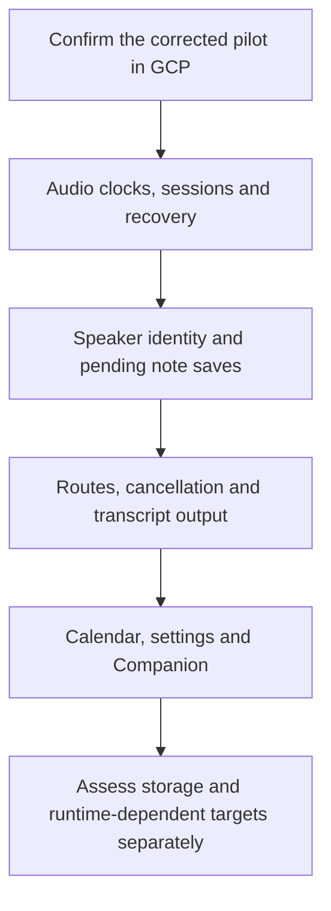

# Proposed TypeScript mutation target map

Execution tracking: [meta issue #346](https://github.com/timurkhakhalev/gristmill/issues/346).
The meta issue and GitHub milestones own task status and dependencies.
This document keeps the initial source-review map.

This is a planning draft. Only `recording:resampler-mapping`,
`recording:clock-sync`, `recording:audio-timeline`,
`recording:system-audio-watchdog`, `recording:session-lifecycle`,
`recording:main-session-lifecycle`, `recording:speaker-assignment`,
`notes:pending-save`, `recording:meet-speaker-evidence`,
`transcription:routing`, `transcription:timeout-policy`,
`transcription:upload-cancellation`, `platform:retry-policy`,
`ai:streaming-think-filter`, `ai:llm-transcript`,
`ai:settings-selection`, `notes:list-operations`, `calendar:availability`,
`platform:endpoint-policy`, `platform:companion-protocol`,
`platform:companion-coordinator`, `recording:platform-speaker-matching`,
`recording:audio-alignment`, `recording:capture-write-queue`,
`notes:transcript-reader`, `recording:retention-settings`,
`notes:read-service` and `recording:processing-retry-policy` are registered in
the explicit allowlist in [scripts/mutation-targets.mts](../../scripts/mutation-targets.mts).
Other IDs below are proposed
contracts, not accepted CLI arguments. This map does not enable new targets,
change tests or start cloud executions.

The canonical inventory has 468 test files: 225 unit, 206 integration, 26 type
and 11 native files. These are classifications, not mutation-readiness counts.
The counts describe this draft's source inspection; use `pnpm test --list` for
current executable inventory. Domain counts overlap because tests can serve
more than one domain.

## Order and execution policy

For each target, read all source exports and their direct consumers, register an
explicit mutation scope and focused test set, then run one cloud dry run. A
successful matching dry run permits a manual full run. A scope, test, runner,
image/toolchain or provider change requires new dry evidence. Keep one cloud
execution and one Stryker worker at a time. Do not run the table as a matrix.

For the pilot, the original cloud instrumented baseline passed but the job
failed during process cleanup. The corrected image passed a local container
dry run. A successful cloud execution of that corrected image is still needed
before its first full run. No mutation score exists yet.

The first batch should contain the pilot plus rows 1–4 below. Review its full
reports and runtime before adding the rest. Do not assign a total duration or
monthly cost to unmeasured targets. Review shared GCP headroom before runs.
Keep the existing five-minute dry and twenty-minute full runner limits. If a
full run reaches its limit, retain its evidence and review the target boundary;
do not increase the limit or remove difficult code only to get a passing score.

## First wave: recording and data preservation

These tests execute production TypeScript with synthetic values, deferred
promises or controlled clocks. They are source-reviewed candidates; they have
not passed mutation dry runs. Runtime imports still need validation in the
actual cloud image.

| Order | Proposed target | Production mutation scope | Focused tests | Behavior to protect |
| --- | --- | --- | --- | --- |
| Pilot | `recording:resampler-mapping` | [meetingResamplerMapping.ts](../../src/helpers/meetingResamplerMapping.ts) | [meetingResamplerMapping.test.ts](../../test/cases/recording/unit/meetingResamplerMapping.test.ts) | Exact anchors, bounds, uncertainty, rate limits and omission of uncalibratable fragments. |
| 1 | `recording:clock-sync` | [meetingClockSync.ts](../../src/helpers/meetingClockSync.ts) | [meetingClockSync.test.ts](../../test/cases/recording/unit/meetingClockSync.test.ts) | Probe validity, generations, uncertainty and clock continuity. |
| 2 | `recording:audio-timeline` | [meetingAudioTimeline.ts](../../src/helpers/meetingAudioTimeline.ts) | [meetingAudioTimeline.test.ts](../../test/helpers/meetingAudioTimeline.test.ts) | Frame anchors and gaps survive delayed delivery. |
| 3 | `recording:system-audio-watchdog` | [meetingSystemAudioWatchdog.ts](../../src/helpers/meetingSystemAudioWatchdog.ts) | [meetingSystemAudioWatchdog.test.ts](../../test/helpers/meetingSystemAudioWatchdog.test.ts) | Distinguish silence from a stalled stream; bound restart and recovery behavior. |
| 4 | `recording:session-lifecycle` | [meetingRecordingSession.ts](../../src/helpers/meetingRecordingSession.ts) | [meetingRecordingSession.test.ts](../../test/helpers/meetingRecordingSession.test.ts) | Start/Stop races, cancellation, note identity and stale restart rejection. Store imports in this source are type-only. |
| 5 | `recording:main-session-lifecycle` | [meetingTranscriptionLifecycle.ts](../../src/helpers/meetingTranscriptionLifecycle.ts) | [meetingTranscriptionLifecycle.test.ts](../../test/helpers/meetingTranscriptionLifecycle.test.ts) | Owner loss, deferred startup, scoped Stop and serialized replacement. Electron's WebContents import is type-only. |
| 6 | `recording:speaker-assignment` | [speakerAssignmentPolicy.ts](../../src/helpers/speakerAssignmentPolicy.ts) | [speakerAssignmentPolicy.test.ts](../../test/helpers/speakerAssignmentPolicy.test.ts) | Automatic naming cannot overwrite a locked user correction. |
| 7 | `recording:platform-speaker-matching` | [meetingPlatformMatcher.ts](../../src/helpers/meetingPlatformMatcher.ts) | [zoomSpeakerMatcher.test.ts](../../test/cases/recording/unit/zoomSpeakerMatcher.test.ts), [soleRemoteSpeaker.test.ts](../../test/cases/recording/unit/soleRemoteSpeaker.test.ts) | Calibrated evidence, rejected names and one-to-one remote identity. Include both consumers. |
| 8 | `notes:pending-save` | [noteEditorPendingSave.ts](../../src/lib/noteEditorPendingSave.ts) | [noteEditorPendingSave.test.ts](../../test/lib/noteEditorPendingSave.test.ts) | Pending user edits survive save ordering and note changes. |

## Second wave: processing and supporting contracts

Each row is a separate bounded target. Start with the listed source scope;
inspect exports not exercised by the listed tests before accepting the target.
Do not treat whole-file test names as proof that every exported behavior is
covered. New or improved business tests require a separate task.

| Proposed target | Production mutation scope | Focused tests | Main boundary or limitation |
| --- | --- | --- | --- |
| `transcription:routing` | [transcriptionRoute.ts](../../src/helpers/transcriptionRoute.ts) | [transcriptionRoute.test.ts](../../test/helpers/transcriptionRoute.test.ts), [transcriptionRouteModelAgreement.test.ts](../../test/helpers/transcriptionRouteModelAgreement.test.ts) | Selected provider/model must agree; use registry fixtures, never a live provider call. |
| `transcription:timeout-policy` | [transcriptionTimeout.ts](../../src/helpers/transcriptionTimeout.ts) | [transcriptionTimeout.test.ts](../../test/helpers/transcriptionTimeout.test.ts) | Duration scaling, unknown duration and floor/ceiling boundaries. |
| `transcription:upload-cancellation` | [uploadCancelRegistry.ts](../../src/helpers/uploadCancelRegistry.ts) | [uploadCancelRegistry.test.ts](../../test/helpers/uploadCancelRegistry.test.ts) | Abort all operations for one request; preserve other requests and released controllers. |
| `platform:retry-policy` | [retry.ts](../../src/utils/retry.ts) | [apiRetryStrategy.test.ts](../../test/helpers/apiRetryStrategy.test.ts), [fileRetryStrategy.test.ts](../../test/helpers/fileRetryStrategy.test.ts) | Both tests classify failures. They do not establish full coverage of the exported `withRetry` execution loop. Bound the initial target to the classifiers, or defer the whole module. |
| `ai:settings-selection` | [settingsSelectors.ts](../../src/config/settingsSelectors.ts) | [settingsSelectors.test.ts](../../test/helpers/settingsSelectors.test.ts) | Meeting, upload, note and chat settings stay separate. Keep behavior assertions; source-policy assertions alone are not mutation evidence. |
| `ai:streaming-think-filter` | [streamingThinkFilter.ts](../../src/services/ai/streamingThinkFilter.ts) | [streamingThinkFilter.test.ts](../../test/services/streamingThinkFilter.test.ts) | Chunk boundaries, nested tags, unfinished tags and visible output preservation. |
| `ai:llm-transcript` | [llmTranscript.ts](../../src/utils/llmTranscript.ts) | [llmTranscript.test.ts](../../test/utils/llmTranscript.test.ts) | Transcript formatting, speaker material and continuity. Imports of recording-store types do not require a live renderer. |
| `notes:list-operations` | [noteListOps.ts](../../src/stores/noteListOps.ts) | [noteListOps.test.ts](../../test/helpers/noteListOps.test.ts) | List updates, folder membership and stale entries. |
| `transcription:export-formatting` | [transcriptFormatter.ts](../../src/helpers/transcriptFormatter.ts) | [transcriptFormatter.test.ts](../../test/helpers/transcriptFormatter.test.ts) | TXT/Markdown/JSON/SRT output, names and timestamps. Keep local i18n JSON files in the image. |
| `calendar:availability` | [calendarAvailability.ts](../../src/helpers/calendarAvailability.ts) | [calendarAvailability.test.ts](../../test/helpers/calendarAvailability.test.ts) | Time offsets, horizon limits, overlap and free-slot boundaries; no calendar API. |
| `platform:endpoint-policy` | [endpointPolicy.ts](../../src/utils/endpointPolicy.ts) | [secureEndpoint.test.ts](../../test/helpers/secureEndpoint.test.ts) | HTTPS, loopback exceptions and host validation. Scoped to the endpoint-policy module after the #404 split. |
| `platform:companion-protocol` | [companionFrames.ts](../../src/helpers/companionFrames.ts), [companion.ts](../../src/contracts/companion.ts) | [companionProtocol.test.ts](../../test/cases/platform/unit/companionProtocol.test.ts) | Frame size, malformed UTF-8/JSON, incomplete messages and protocol bounds. |
| `platform:companion-coordinator` | [companionCoordinator.ts](../../src/helpers/companionCoordinator.ts) | [companionCoordinator.test.ts](../../test/cases/platform/unit/companionCoordinator.test.ts) | Call/recording binding, identity and reminder state without Chrome. |
| `recording:meet-speaker-evidence` | [meetSpeakerEvidence.ts](../../src/helpers/meetSpeakerEvidence.ts) | [meetSpeakerEvidence.test.ts](../../test/cases/platform/unit/meetSpeakerEvidence.test.ts) | Continued active-speaker evidence and bounded calibrated episodes without a browser. |

## Conditional wave: inspect or prepare the runtime first

These areas have high product value, but the current image or test boundary
needs more work before they become mutation targets. This is not approval for
that implementation work.

| Area | Existing evidence | Gate before mutation |
| --- | --- | --- |
| Audio alignment beyond the pilot | [meetingAudioAlignmentPerformance.test.ts](../../test/cases/recording/unit/meetingAudioAlignmentPerformance.test.ts), [meetingSourceExportAlignment.test.ts](../../test/cases/recording/integration/meetingSourceExportAlignment.test.ts) | Inspect [meetingAudioAlignment.ts](../../src/helpers/meetingAudioAlignment.ts) across all consumers. Separate behavior checks from performance assertions and native decoding. Do not infer full alignment coverage from the mapper pilot. |
| PCM worklet and backpressure | [meetingPcmProcessor.test.ts](../../test/cases/recording/unit/meetingPcmProcessor.test.ts), [meetingCaptureBackpressure.test.ts](../../test/cases/recording/unit/meetingCaptureBackpressure.test.ts) | Tests execute a JavaScript template string from [meetingAudioPipeline.ts](../../src/helpers/meetingAudioPipeline.ts) in a VM. Ordinary TS AST mutation does not mutate its embedded worklet statements. Replacing the whole string is not useful statement-level evidence. A separate design decision is needed. |
| Audio assembly and transcript selection | [meetingAudioParts.test.ts](../../test/helpers/meetingAudioParts.test.ts), [noteTranscriptReader.test.ts](../../test/helpers/noteTranscriptReader.test.ts), [noteReadService.test.ts](../../test/helpers/noteReadService.test.ts) | Inspect mixer/storage imports and all exports. The parts test observes composition but does not prove FFmpeg/export coverage. Do not mutate all of [meetingAudioMixer.ts](../../src/helpers/meetingAudioMixer.ts) using only pure composition tests. |
| Recording storage, crash recovery and retention | [meetingRecordingStorage.test.ts](../../test/helpers/meetingRecordingStorage.test.ts), [meetingCaptureRecovery.test.ts](../../test/helpers/meetingCaptureRecovery.test.ts), [meetingRecordingRetention.test.ts](../../test/helpers/meetingRecordingRetention.test.ts) | Synthetic SQLite/profile fixtures are mandatory. Verify Opus/FFmpeg and fixture resources: the current image skips install scripts and rebuilds only SQLite. A complete database/IPC mutation scope is too broad for the first pilot. |
| Post-Stop orchestration and note output | [meetingProcessing.test.ts](../../test/helpers/meetingProcessing.test.ts), [noteOutputReader.test.ts](../../test/cases/notes/integration/noteOutputReader.test.ts), [noteOutputHook.test.ts](../../test/cases/notes/integration/noteOutputHook.test.ts) | Trace worker, storage, media and renderer harness requirements. Narrow by behavior such as cancellation, retry or selected result; preserve complete source recordings. |
| Renderer stores and emitted main/preload code | [meetingRecordingStoreAutoEndStop.test.ts](../../test/stores/meetingRecordingStoreAutoEndStop.test.ts), [speakerBridge.test.ts](../../test/cases/recording/integration/main/speakerBridge.test.ts) | Inspect DOM/SSR stubs and emitted-code needs. The current image does not copy root tsconfigs or build main/preload. Expand the image only for a demonstrated target, then repeat dry validation. |

## Outside this mutation queue

- Keep compiler probes and import-boundary checks in their ordinary checks.
  They protect structural/type contracts and are not runtime mutation targets.
- Keep pure source-text, copy-presence, packaging and wiring assertions outside
  the mutation queue unless they also observe an enforced behavior boundary.
- Native macOS capture, system permissions, Keychain, Swift helpers, packaged
  Electron and actual device tests stay on an isolated macOS Apple Silicon
  runtime. Linux Cloud Run cannot establish their hardware guarantees.
- Live provider calls, real browser meetings, real profiles, real contacts and
  production recordings do not belong in the mutation image or reports.

## Result review

Keep Killed, Survived, Timeout, RuntimeError and CompileError separate. The
command runner uses `coverageAnalysis: off`: it cannot distinguish an uncovered
mutation from other survivors. Do not claim NoCoverage classification from this
configuration. It also reports one command-level test rather than individual
`node:test` cases. Inspect the canonical test output for actual case evidence.

Retain metadata and full JSON/HTML reports privately, with their fingerprint and
image digest. No universal blocking score is proposed. Classify survivors by
missing observation, unreachable path or a specifically demonstrated equivalent
mutation. Do not shrink meaningful scope or rewrite tests in this mapping task.
