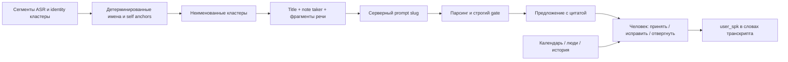
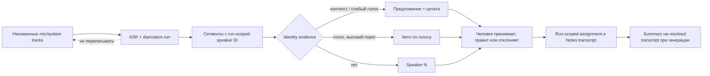

# Как OpenHercules может перейти от Speaker 1/2/3 к именам

Исследование на 28 сентября 2026 года. Репозиторий и приложения читались без изменения исходников или пользовательских профилей. Внешние страницы проверены на дату исследования. Локальный Granola — установленная версия **7.595.2**, `app.asar` SHA-256 `6e2fb394161c612d829f2a6fdfa108b873e7ff8635118029c8982311f1209000`. Код Granola — статическое свидетельство о клиенте; флаги, серверная логика и фактическое поведение конкретного аккаунта могут отличаться.

## Короткий вывод

`Speaker 1` — результат диаризации (кластер речи), не установленная личность. OpenHercules уже умеет распознавать **ранее сохранённые голосовые профили** и вручную назначать имя кластеру конкретного processing run. Имя не возникнет, если профиля с embedding нет, модель embedding недоступна, сегменты слишком короткие/некачественные, сходство не превысило `0.6`, либо распознавание пропущено после ошибки. Само исправление спикера в Meeting Results сохраняет имя для run, но **не создаёт голосовой профиль**. Кроме того, summary генерируется из `transcript.text`, а не из проекции с исправлениями: исправленное имя в транскрипте не попадает в уже созданное summary автоматически.

Рекомендация: сначала исправить понятность и поток подтверждения уже существующего механизма; затем добавлять консервативные предложения имён из голоса и контекста, не превращая календарных участников в доказательство личности. Не вводить новый провайдерный или плагинный слой.

## 1. Текущий путь OpenHercules

| Этап | Подтверждено кодом | Следствие |
|---|---|---|
| Захват и ASR | Исходные mic/system остаются раздельными; post-Stop обработка производит полный derived mono WAV, а ответ провайдера сохраняется до нормализации (`docs/record-then-process.md:7,31-47`). `meetingProcessing.ts:521-540` использует интегрированную диаризацию провайдера либо локальную `diarizeLocal`. | Диаризация даёт временные сегменты и opaque `speaker` ID, но не имя человека. |
| Автоузнавание | `src/helpers/ipcHandlers.ts:1194-1217` подключает `recognizeMeetingSpeakers`; `src/helpers/meetingProcessing.ts:546-562` вызывает его после сохранения transcript artifact и записывает совпадения как `meeting_run_speaker_corrections`. | Автоузнавание происходит после ASR и зависит от доступного аудио и профилей. |
| Сигнал голоса | `src/helpers/meetingSpeakerRecognition.ts:26-82`: модель должна быть доступна; для каждого кластера берутся до трёх самых длинных сегментов, извлекаются embeddings, строится centroid, выбирается лучший профиль при similarity `> 0.6`; один профиль не назначается двум кластерам одного run. `speakerEmbeddings.ts:26-39,86-87` проверяет модель и минимальную длину фрагмента. | Пустая база профилей и отсутствие модели закономерно оставляют Speaker N. Порог есть, но доказательства его качества на пользовательских записях нет. |
| Профили | `src/helpers/database.ts:914-946,3107-3135`: `speaker_profiles` содержит имя, email, embedding; отдельно `speaker_mappings`, `note_speaker_embeddings` и `meeting_run_speaker_corrections`. `speakerIpcHandlers.ts:141-172` создаёт/обновляет профиль при обычном `setSpeakerMapping`, **если** найден embedding заметки или live identifier. | Старые профили могут помочь; простое имя без образца голоса не делает будущие встречи узнаваемыми. |
| Исправление Meeting Results | `MeetingResultsPanel.tsx:240,361-373,532-569`: неподтверждённый кластер рисуется как Speaker 1/2/3, клик открывает имя и необязательный выбор существующего профиля. `meetingProcessing.ts:233-252` сохраняет run correction. `database.ts:1557-1605` меняет выбранную проекцию transcript, но не raw artifact и не `speaker_profiles`. | Выбор профиля в этом диалоге лишь сохраняет `profile_id` в correction; новый голосовой образец там не зачисляется. Это важное UX расхождение между ожиданием «запомнить голос» и фактом. |
| Проекция в Notes | `meetingProcessing.ts:814-840` добавляет `speakerName` к сегментам из corrections, остальные помечает provisional. `transcriptFormatter.ts:24-37` при экспорте отдаёт реальное имя, mapping или Speaker N. | Текст/экспорт могут обновиться без переписывания provider response. Автоузнанная correction в проекции получает `speakerLockSource: "user"` (`meetingProcessing.ts:829-834`), хотя пользователь её не подтверждал: источник доверия теряется. |
| Summary | `meetingProcessing.ts:569-598` передаёт в LLM `manual` + **`transcript.text`**, сохраняет отдельный summary artifact; `meetingProcessing.ts:212-225,703-716` публикует его вместе с проекцией. | Исправление имени обновляет проекцию transcript, но не переписывает summary и не регенерирует его. Даже следующий summary run читает сырой `transcript.text` (`:576-584`), так что исправленные имена не гарантированы в новых заметках. |

**Confirmed:** код выше и задокументированное требование `docs/product.md:46` («calendar participants are hints»). **Inferred:** конкретные Speaker N у Тимура, вероятнее всего, означают, что для соответствующих run не создана correction; без чтения приватной БД, логов и аудио нельзя выбрать между «нет профиля», «нет модели», «голос не совпал», «ASR ошибся в кластерах» и «распознавание сбойнуло». **Unknown:** точность порога `0.6`, состояние установленных моделей и наличие профилей на машине пользователя. Их нельзя выводить из одного скриншота.

## 2. Что действительно делает локальный Granola

Статические адреса ниже относятся к `app.asar` 7.595.2; offset — смещение символов внутри названного JS-файла, а не стабильная строка исходника. Для цитирования достаточно коротких свидетельств; minified bundle не воспроизводится.

| Механизм | Свидетельство локального клиента | Граница вывода |
|---|---|---|
| Модельные предложения имени | `dist-app/assets/calendarEvents-DxRnXwY9.js`, offset ~12900-14500: клиент вызывает API с `prompt_slug: "speaker-name-suggestions"`, `document_id`, `prompt_variables: {input}`. В `input` входят заголовок встречи, note-taker, блок уже известных спикеров и текст реплик с `[mic]` / `[system]`. Выход парсится как `mappings`, `confidence`, `evidence`, `unlisted_speakers_suspected`. | **Тела серверного prompt в bundle нет.** Видны slug, клиентская сборка входа и проверка ответа; неизвестно, как сервер формулирует задачу модели. |
| Фильтр | Там же ~3000-5050, ~13200-14100: принимаются только `confidence === "certain"` плюс один из `self_introduction`, `addressed_and_answers`, `elimination`, `vocative_exclusion`, `platform_attribution`; elimination требует `unlistedSpeakersSuspected === false`; чисто `platform_attribution` дополнительно отвергается как возможная галлюцинация. Неразрешённые личности остаются с `name: null`. | Это клиентский gate для **предложения**, не автоматическое доказанное назначение имени. |
| Момент запуска | Там же ~14500-16000: при завершении встречи ждёт финального speaker результата до 15 секунд, пропускает активную/возобновляемую сессию, затем сохраняет предложения в локальной `speaker_name_suggestions`; флаг `speaker_name_suggestions` имеет `defaultValue: false` (`cache-B-jyBe4G.js` ~48400). | Наличие кода не означает, что фича включена всем пользователям. |
| Подтверждение и правка | `calendarEvents-DxRnXwY9.js` ~6300-8000: принятие имени добавляет `user_spk` к словам выбранного identity через API update и убирает предложение; отказ убирает предложение. `PersonDetailView-Qs9VKtiQ.js` ~1794600 и ~1800000: варианты «Attendees», «You», «People», «In this transcript» и кнопки «Not them» / «Confirm». | Календарь и история питают **roster для человека**, а не равенство «приглашён = говорил». В модельный input видно title и note-taker, но не полный attendee roster. |
| Свой микрофон / платформа | `calendarEvents-DxRnXwY9.js` ~10800-13100 строит `[mic]`/`[system]`, self/known anchors и unknown identities; `inferProviderMicOwner` включается, когда владелец meeting совпадает с note-taker. | Клиент различает source и identity. Дополнительные platform attribution механизмы видны в bundle, но их точность/наличие на каждой платформе этим не доказаны. |
| Voice profile | `cache-B-jyBe4G.js` ~55300-55500: `voice_fingerprint_poc`, `voice_fingerprint_internal_collection` по умолчанию false. `dist-electron/main/index.js` ~6769900-6772300 пишет отдельный mic WAV при POC; ~6776300 хранит self voiceprint; ~6791000-6793900 сравнивает self-embedding после диаризации для in-person relabel. Internal collection ограничена флагом и `@granola.so` (~6778140); dev IPC содержит `voice-fingerprint:*` (~6803360). | В установленном клиенте есть **экспериментальный self-voiceprint path**, но нет основания заявлять о массовой библиотеке голосов всех участников или о включённой функции на этом аккаунте. Пользовательский профиль Granola не читался. |

Схема видимого пути Granola:

Публичная документация Granola подтверждает, что enhanced notes используют transcript, ручные заметки и сведения события календаря, но не раскрывает внутренний алгоритм speaker-to-name: [Granola Help, AI-enhanced notes](https://help.granola.ai/article/ai-enhanced-notes). Поэтому источником деталей цепочки выше служит именно локальный клиент.

## 3. Конкуренты: что подтверждено

Название **Anarlog** оказалось точным: [anarlog.so](https://anarlog.so/) и [исходники `fastrepl/anarlog`](https://github.com/fastrepl/anarlog). Название **Muesli неоднозначно**: существуют как минимум [`Muesli-HQ/muesli`](https://github.com/Muesli-HQ/muesli), [`forjd/muesli`](https://github.com/forjd/muesli), [`scottscotthendo/muesli`](https://github.com/scottscotthendo/muesli) и [`abedegno/muesli`](https://github.com/abedegno/muesli). Для основного сравнения взят Muesli-HQ как близкий macOS bot-free meeting/transcription продукт; вывод нельзя переносить на одноимённые проекты.

| Продукт | Что наблюдается / заявлено о speaker-to-name | Надёжный урок для OH |
|---|---|---|
| **Anarlog**, source `9ee80f5b` | Сайт заявляет manual speaker labeling в Free и «Better Speaker Identification» в Pro ([продукт](https://anarlog.so/)). Реальный [Rust resolver](https://github.com/fastrepl/anarlog/blob/9ee80f5b2c00341679f22036edf010bc4752c9ef/crates/transcript/src/speaker_context.rs#L98-L201) отличает explicit `speaker_human_id` от `provisional_speaker`, а неизвестным оставляет Speaker N. Для mic применяет изоляцию/один локальный голос; для remote **только одного** известного другого участника даёт provisional имя ([строки 204-270](https://github.com/fastrepl/anarlog/blob/9ee80f5b2c00341679f22036edf010bc4752c9ef/crates/transcript/src/speaker_context.rs#L204-L270)). [UI assignment](https://github.com/fastrepl/anarlog/blob/9ee80f5b2c00341679f22036edf010bc4752c9ef/apps/desktop/src/session/components/note-input/transcript/renderer/speaker-assign.tsx#L59-L95) предлагает участников календаря и контакты, ждёт Confirm, позволяет применить ко всем. | Полезно явно отделять provisional контекст от назначения человеком. Не считать маркетинговое «better» описанием реализации Pro. |
| **Muesli-HQ**, source `d457aaf` | [README](https://github.com/Muesli-HQ/muesli) прямо говорит про `You`/`Others` и `Speaker 1/2` после FluidAudio diarization. [Код RecordedAudioDiarizationSession](https://github.com/Muesli-HQ/muesli/blob/d457aaf94691a73afd2867f5a6ca7fdd203044db/native/MuesliNative/Sources/MuesliNativeApp/MeetingRecordingTranscriber.swift#L75-L130) сбрасывает speaker manager для каждого job и не разделяет identity между jobs. [Transcript parser](https://github.com/Muesli-HQ/muesli/blob/d457aaf94691a73afd2867f5a6ca7fdd203044db/native/MuesliNative/Sources/MuesliNativeApp/MeetingDetailView.swift#L2145-L2170) распознаёт `Speaker N` как отображаемый label. В просмотренных путях нет подтверждения сопоставления с реальными именами. | Диаризация сама по себе даёт только устойчивые **в рамках записи** номера. Не обещать распознавание личностей по соседству с календарём. |
| **Otter.ai** | [Speaker Identification Overview](https://help.otter.ai/hc/en-us/articles/21665587209367-Speaker-Identification-Overview) (обновлено 1 апреля 2026) прямо разделяет новые Speaker # и уже обученные профили. [Tagging names](https://help.otter.ai/hc/en-us/articles/360048465453-Tagging-speaker-names-in-a-conversation) описывает подтверждение и rematch старых встреч. [Disable Speaker Learning](https://help.otter.ai/hc/en-us/articles/40643231903639-Disable-Speaker-Learning) отделяет диаризацию, platform names, ручные теги и сохранённый голос; ручной тег при выключенном learning не образует enrollment. | Явно объяснять, создаёт ли действие голосовой профиль или лишь метку встречи. Источник имени виден пользователю. |
| **Fireflies.ai** | [Руководство для загруженного аудио](https://guide.fireflies.ai/articles/1234873612-how-to-edit-speaker-labels-in-uploaded-files) (15 июня 2026): Speaker N вручную переименовывается для одной реплики или всех совпадающих Speaker X; исходное аудио не меняется; после правки рекомендуют Regenerate notes для корректных summary/action items. | Нужны разные области исправления при ошибочном объединении кластеров и явная повторная генерация summary. |
| **Fathom** | [Name Picker](https://help.fathom.video/en/articles/297152) (27 августа 2025) подбирает **самого пользователя** по имени Zoom/alias и просит выбрать, если совпадения нет. [In-person FAQ](https://help.fathom.video/en/articles/5500225) (27 августа 2026) признаёт, что несколько людей у одного физического микрофона не различаются и всё может быть отнесено к пользователю. | Имя из платформы полезно, когда платформа действительно привязывает активного участника к реплике; общий микрофон ломает предположение «один канал = один человек». |

## 4. Простой staged подход для OpenHercules (без реализации)

### Stage 0 — ясная семантика того, что уже есть

1. В UI различить **«Speaker N — неизвестен»**, **«предложено: Имя»**, **«авто по голосу: Имя»**, **«подтверждено: Имя»**. Не маркировать auto correction как `speakerLockSource: user`. Показать причину отсутствия автосовпадения на уровне агрегата, без текста/аудио в логах: нет модели, нет профилей, не хватило пригодных сегментов, нет совпадения, ошибка.
2. В диалоге correction отделить «Переименовать в этой версии» от «Запомнить голос для следующих встреч». Последнее доступно лишь при достаточном чистом embedding и осознанном выборе пользователя; текущее Meeting Results исправление профиля не обучает.
3. После коррекции делать Notes transcript проекцией из неизменного raw run artifact + run-scoped identity assignments. Summary помечать устаревшим и предлагать повторную генерацию **с разрешёнными именами**; не менять его автоматически и не затирать ручные заметки.

### Stage 1 — осторожное автоматическое узнавание

Использовать уже существующий `speaker_profiles`/embedding путь, но калибровать порог на контрольных русских встречах, оценивать короткие реплики и overlapping speech отдельно. Предлагать имя только при достаточной длительности голоса, хорошем сходстве и отрыве от второго кандидата; при конфликте одного профиля с двумя кластерами оставить неизвестными/предложенными. Встреча и каждый processing run сохраняют свои speaker IDs и assignments; новая обработка другим ASR не наследует номер `speaker_0` как личность. Сохранять причину/сигнал и решение пользователя отдельно от raw transcript.

### Stage 2 — контекстные подсказки без ложного доказательства

Список приглашённых, контакты и название встречи использовать только для **выбора человеком** и для предложения с цитатой («я Тимур», обращение + ответ). Участник в календаре мог не прийти; человек вне списка мог говорить; имя в речи может относиться к третьему лицу. Mic/system — подсказка источника, не личность: у микрофона может быть несколько человек, а один голос может попадать на обе дорожки. Если модель предлагает имя, показывать фрагмент речи и уверенность; auto apply только для детерминированного подтверждённого совпадения, а сомнительные варианты оставлять Speaker N. Возможность принять/исправить/отвергнуть и применить ко всему кластеру; для ошибки самой диаризации — отдельное исправление конкретного сегмента/разделение кластера.

### Минимальная проверка решения

До выпуска сопоставить на размеченных 1:1 и 3+ русскоязычных встречах: точность кластера (кто когда говорил), точность имени **отдельно**, долю false positive имен, abstain rate, качество после исправления, сохранность выбранной версии при повторной обработке и устаревание summary. Отдельно проверить общий микрофон, эхо, перекрытие речи, отсутствовавшего приглашённого, незапланированного гостя и смену провайдера. Аппаратный сценарий остаётся необходимым: тесты кода не доказывают качество реального dual-track звука.

## Источники и границы

- OpenHercules: `src/helpers/meetingSpeakerRecognition.ts`, `meetingProcessing.ts`, `database.ts`, `speakerIpcHandlers.ts`, `src/components/notes/MeetingResultsPanel.tsx`, `docs/product.md`, `docs/architecture.md`, `docs/record-then-process.md` — рабочее дерево прочитано 28 сентября 2026; приватные БД, профили, аудио и заметки не открывались.
- Granola: `/Applications/Granola.app/Contents/Resources/app.asar` 7.595.2 — статический клиентский bundle, SHA выше. Для просмотра извлечены только JS-файлы во временную `/tmp/oh-granola-speaker-research`; пользовательский Granola profile не открывался.
- Anarlog: исходники по commit [`9ee80f5b`](https://github.com/fastrepl/anarlog/tree/9ee80f5b2c00341679f22036edf010bc4752c9ef), официальный [сайт](https://anarlog.so/).
- Muesli-HQ: исходники по commit [`d457aaf`](https://github.com/Muesli-HQ/muesli/tree/d457aaf94691a73afd2867f5a6ca7fdd203044db), официальный [README](https://github.com/Muesli-HQ/muesli).
- Otter, Fireflies, Fathom: ссылки на первичные страницы указаны непосредственно в таблице; они описывают продуктовые правила, а не внутренний код.
