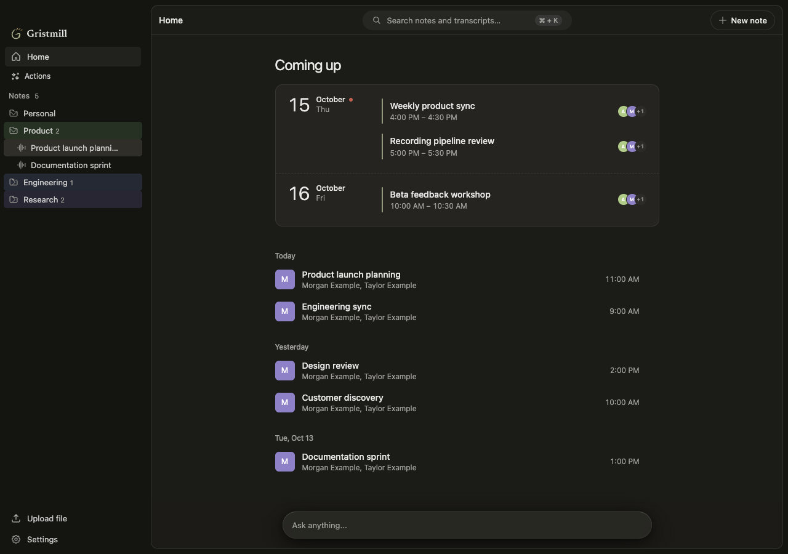
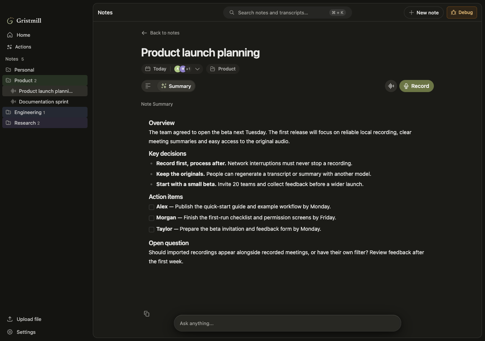
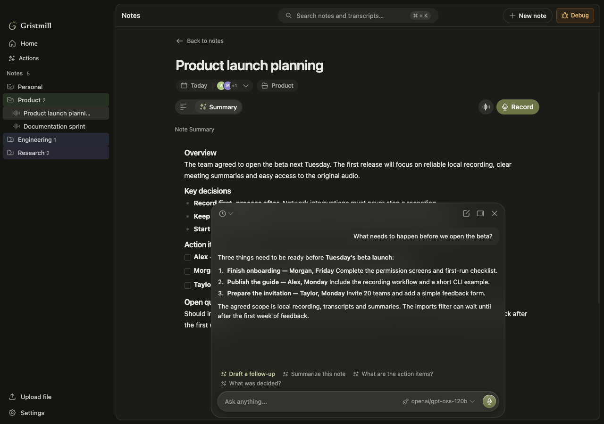

<p align="center"></p>

# Gristmill

_Meeting notes, milled fine._

Gristmill is a meeting recorder and notes app for macOS on Apple Silicon.
It does not add a bot to the call.
It started from a one-time import of [OpenWhispr](https://github.com/OpenWhispr/openwhispr) (MIT license).

## Core promise

The recording is the source of truth.
A transcript, speaker labels and a summary are artifacts.
You can regenerate them with a different provider or model.

Gristmill never shows a meeting as complete when an audio channel is missing.
It also never shows a meeting as complete when a processing stage used only part of the recording.

## What it does

- Records the microphone and the system audio as separate local tracks (Ogg/Opus).
- Continues to record during network, VPN and cloud-provider failures.
- After Stop, transcribes the finished recording with the selected provider (ElevenLabs, Deepgram, Gemini, OpenAI or Local). Speaker diarization runs in the same pass when the provider supports it.
- Matches transcript speakers to meeting participants using Zoom Accessibility or the Google Meet and Telemost Companion extension. You can correct speaker names.
- Makes a Summary with prioritized tasks. A Recap and a Follow-up draft are available on request.
- Gives a chat for each meeting and a Home chat that can search across your notes.
- Uses cloud APIs, on-device models or self-hosted language models for chat and summaries. The optional [bb](https://getbb.app) integration also lets you use coding-agent harnesses with your existing provider subscriptions.
- Lets you play, export and process the original audio again.
- Connects meetings to calendars and participants.
- Links Google Meet and Telemost calls through the [Gristmill Companion](.memory-bank/product/user-journeys/companion.md) Chrome extension.
- Gives read-only access to notes from the terminal through the [`gristmill` CLI](.memory-bank/product/user-journeys/gristmill-cli.md).
- Lets you choose a color scheme and accent colors in Settings.

## Screenshots

The screenshots use fictional meetings and contacts in an isolated development profile.

### Home



### Meeting summary



### Chat



## Your data

Gristmill has no cloud backend of its own and does not require a Gristmill account.
Recordings, transcripts, notes and chat history are stored on your Mac in a local SQLite database and managed files.
Provider API keys are stored encrypted on your Mac.

Recording does not depend on a network connection. Processing depends on the route you select:

- **Cloud APIs:** the selected transcription provider receives the saved audio. The selected summary or chat provider receives the text needed for that task.
- **On-device:** audio and text are processed on your Mac. Models and their engines need an initial download.
- **Self-hosted:** summary and chat requests go to the server you configure.
- **bb:** summary and chat requests run through the harness and provider configured in bb.

You can export the original audio and process it again with a different transcription provider. You can also regenerate a Summary without transcribing the audio again.

## Run from source

There are no prebuilt releases yet. To run Gristmill from source, you need:

- A Mac with Apple Silicon. System audio recording requires macOS 14.2 or later.
- Node 24 or later and pnpm 10.19.0.
- The Xcode command-line tools.

```sh
git clone https://github.com/timurkhakhalev/gristmill.git
cd gristmill
pnpm install --frozen-lockfile
pnpm dev
```

`pnpm dev` runs Gristmill Dev with a separate development profile.
On its first launch, the default Dev profile copies a snapshot of an existing production profile, if present. An explicit `--user-data-dir` keeps a test profile empty and isolated. See [local builds and profiles](.memory-bank/runbooks/local-builds.md).

### First launch

1. Grant microphone and system audio access. Enable Accessibility for Zoom integration.
2. Select a meeting transcription provider and add its API key, or download and select an on-device speech model in Settings.
3. Select a separate model for Meeting summary and Chat in **Settings → Models**. These tasks also support self-hosted models and bb.
4. Optionally connect Apple Calendar, Google Calendar or Microsoft Outlook.
5. For Google Meet and Telemost, install [Gristmill Companion](.memory-bank/product/user-journeys/companion.md) from **Settings → Recording**. The extension is loaded unpacked in Chrome.

Source builds need your own Google Calendar Desktop OAuth client. Set `GOOGLE_CALENDAR_CLIENT_ID` and `GOOGLE_CALENDAR_CLIENT_SECRET` as described in [.env.example](.env.example). Without them, Google Calendar is unavailable; manual recording and Apple Calendar still work.
Microsoft Outlook also needs your own OAuth app registration and `MICROSOFT_CALENDAR_CLIENT_ID` in your local `.env`.

### Use bb

Install and configure [bb](https://getbb.app), then enable the harnesses in **Settings → Providers → Coding agents (bb)**.
Select **bb** for Meeting summary or Chat in **Settings → Models**, or select a harness from the chat composer.
Transcription uses its own cloud or on-device route.
See [BB integration](.memory-bank/architecture/bb-integration.md).

### Use the CLI

The packaged app installs `gristmill` in `~/.local/bin`. Add that directory to your shell `PATH` if needed, and keep the app open while you use the CLI.

```sh
gristmill doctor
gristmill notes list
gristmill notes transcript show 42
```

Replace `42` with a note ID from the list. The CLI can also read user notes and Summaries, search transcripts, and return JSON for scripts and external agents. It cannot change or delete your data.
See [Gristmill CLI](.memory-bank/product/user-journeys/gristmill-cli.md).

## Build an app

Create an unsigned app bundle without a signing certificate:

```sh
pnpm run pack
```

The bundle is written to `dist/mac-arm64/Gristmill.app`.

To build, install and start a locally signed app, first create or import a persistent self-signed certificate named **Gristmill Local Signing** in your login keychain, then quit Gristmill and run:

```sh
pnpm run update:local
```

This command installs the app in `/Applications`. It does not notarize the app. For a notarized app that you can distribute to other Macs, use a Developer ID certificate.
Signing, the separate Dev app and profiles: [local builds](.memory-bank/runbooks/local-builds.md).

## Development checks

```sh
pnpm run typecheck
pnpm run lint
pnpm test                       # full suite
pnpm test --domain calendar     # one domain
pnpm run build:renderer
```

All commands: [project commands](.memory-bank/steerings/project-commands.md).

## Documentation

All project documentation is in the [Memory Bank](.memory-bank/index.md):

- [Product](.memory-bank/product/index.md): requirements, scope, user-facing behavior.
- [Architecture](.memory-bank/architecture/index.md): how recording, processing and integrations work.
- [Decisions](.memory-bank/adr/index.md): why the system is like this.
- [Steerings](.memory-bank/steerings/index.md): quality policy and commands.
- [Runbooks](.memory-bank/runbooks/index.md): builds and troubleshooting.

Agents start at [AGENTS.md](AGENTS.md).

## License

MIT. See [LICENSE](LICENSE). Gristmill keeps the OpenWhispr license and attribution.
Import provenance: [docs/openwhispr-upstream/IMPORT.md](docs/openwhispr-upstream/IMPORT.md).
