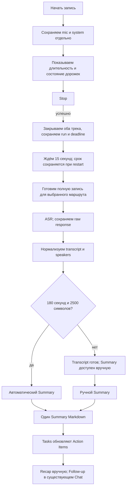

# Запись → Stop → обработка

Автообработка после Stop/End call включает все доступные завершённые части аудио
этой Note независимо от `group_id`, в порядке `startedAt`, затем ID. Main
сохраняет этот набор до ASR; новый захват отменяет ожидающую обработку той же
Note. Группы описывают сеансы захвата, а не полноту транскрипта. Сборка аудио
сама сортирует части. Старые результаты и BB-треды сохраняются; ранее разделённую
запись нужно транскрибировать заново для полного результата.

Решение Тимура от 2026-09-23. Заменяет предложения о транскрипции фрагментов во время встречи и локальном черновике. M1–M4 код этой схемы реализован; focused и интеграционная проверка остаются за root. Live mic/system hardware smoke отложен и остаётся непроверенным.

Доработка хранения: [Opus capture и миграция](opus-recording.md).

## Текущая реализация и проверка

- SQLite хранит `meeting_recordings`, `meeting_recording_epochs`, `meeting_processing_runs`, `meeting_deletion_intents` и `meeting_run_speaker_corrections`; managed files содержат source Ogg/Opus epochs (32 kbit/s VBR, complexity 0), temporary derived WAV и per-run JSON results. Пути описаны в [architecture.md](architecture.md).
- Config snapshot сохраняется до первого audio frame. Во время capture нет ASR/provider calls. Только успешный Stop закрывает tracks, создаёт initial run и сохраняет not-before deadline на 15 секунд. Worker учитывает этот deadline после restart; Pause не ставит задание в очередь, а Resume отменяет pending run прежней Note audio version.
- После gate формат зависит от сохранённого провайдера: Deepgram получает stereo WAV (mic=0, system=1) с multichannel и диаризацией; ElevenLabs, Gemini и OpenAI — два параллельных запроса (mic без диаризации, system с диаризацией). OpenAI использует `whisper-1` для временных меток mic и `gpt-4o-transcribe-diarize` для system. Local сохраняет mono route. Все входы следуют общей timeline и сохраняют gaps. Raw JSON каждой дорожки сохраняется до normalization; retry не отправляет успешную дорожку повторно. Run/selection проверяются перед claim и ASR.
- Transcript и Summary — per-run artifacts; `notes.transcript` и `notes.enhanced_content` показывают выбранный run, а ручной `note.content` остаётся отдельным. Source tracks и прошлые артефакты сохраняются при retry и выборе другой версии.
- Speaker naming выполняется после сохранения транскрипта, до необязательного Summary, в том числе по кнопке Transcribe. Отдельная кнопка Summary использует сохранённые имена и не вызывает naming повторно. Naming может использовать сохранённый Summary route; user correction wins by revision. Первый автоматический Summary создаётся при длительности не менее 180 секунд и не менее 2 500 символов transcript. Явная повторная транскрипция создаёт новый Summary для непустого transcript независимо от прошлых версий и этих порогов; для готового transcript также доступен ручной Summary.
- Settings → Profile и онбординг предлагают имя пользователя. Оно сохраняется в config snapshot и назначается mic-репликам; пустое имя даёт «Вы»/«You». Предполагается один человек у микрофона. Эхо и новые образцы голоса не входят в эту доработку.
- В LLM передаётся plain text внутри `<transcript>`: `Speaker N: "реплика"`. Mic занимает Speaker 1, остальные получают стабильные в рамках transcript метки; имена и источник audio указаны отдельно. Соседние реплики одного спикера объединяются. JSON и ID реплик остаются внутренними данными. Naming возвращает эти же метки, которые приложение переводит обратно в source IDs. В BB один и тот же transcript не отправляется повторно в сохранённый thread; принятые имена передаются отдельно.
- В редакторе спикера можно связать имя с email участника календаря. Имя хранится локально в contacts.learned_name, переживает Google sync и обогащает кандидатов следующих встреч. Автоматическая связь допустима только при единственном точном совпадении имени; email без имени требует выбора пользователя. Номера спикеров между встречами не переиспользуются как идентичность.
- Summary хранится как один Markdown artifact. После сохранения Tasks заполняют существующий `## Action Items` или удаляют его для zero tasks; Recap вручную добавляет/обновляет `## Recap` в этом же artifact. Follow-up — обычный assistant message в существующем Chat, без отправки наружу.
- Naming и Recap проверяют строгий JSON и допускают один repair turn только в той же selected-provider conversation. Отказ и transport error не вызывают repair. Tasks возвращают Markdown без JSON repair (пустой ответ означает отсутствие задач). BB repair использует сохранённый thread; его adapter получает только final text, без native refusal metadata.
- Историческое [chunking research](transcription-chunking-research.md) сохранено как superseded proposal preview/обработки во время встречи; это не текущий pipeline.
- M1–M3 focused root test gates пройдены. M4 focused/full checks ожидают root; live mic/system tail-loss/recovery остаётся непроверенным.

Команды root-owned проверки:

```sh
pnpm run lint
pnpm run typecheck
pnpm test
```

Root runs these checks sequentially after any focused rerun. Hardware smoke — отдельная изолированная macOS arm64 проверка; её нельзя считать выполненной по этому документу.

## Согласованная схема

Проверка доработки раздельных источников, 2026-09-29:

- `pnpm test`: полный набор из 397 файлов прошёл. Проверены параллельные запросы, сохранение успешного источника при ошибке второго, восстановление после restart, запрет смены provider при частично сохранённом ответе и назначение имени из Profile.
- `pnpm run typecheck`, `pnpm run lint`, `pnpm run build:renderer`: успешно; lint содержит существующие предупреждения, без ошибок.
- Реальный FFmpeg проверен на сигналах с известными отсчётами: stereo сохраняет mic слева и system справа, отдельные WAV сохраняют offsets, gaps и длительность. Это проверка предыдущей PCM реализации; текущий Opus проверяется по длительности, каналам и наличию сигнала, без побайтового сравнения декодированного звука.
- Profile и шаг онбординга проверены в изолированном браузере: сохранение имени, восстановление между экранами и пропуск пустого имени.
- Один и тот же 45-секундный фрагмент сохранённой встречи отправлен в Deepgram Nova-3 в mono и stereo. Новый ответ успешно разобран: 25 слов mic, 88 слов system, два системных спикера, длительность обоих вариантов 44.99994 секунды. Запрос stereo использовал `multichannel=true` и `diarize_model=latest`. Это проверка реального API и разделения источников, не измерение WER или сравнительный benchmark.
- Живые запросы ElevenLabs/OpenAI/Gemini и новый захват с устройств в этой проверке не выполнялись; их маршруты покрыты тестами с сохранением и разбором provider responses.



- Во время встречи выполняются захват, сохранение и контроль состояния. ASR, диаризации, черновика и автоматических заметок нет. Ручные заметки остаются доступны.
- Исходные mic/system записываются один раз. Чанки файлов нужны для сохранности и восстановления, а не для отправки отдельных минут в ASR.
- Только успешный Stop фиксирует завершённый хвост и создаёт run с durable 15-секундным not-before сроком. Pause не ставит обработку в очередь; Resume инвалидирует pending work прежней Note audio version. Run повторно проверяется при claim и перед ASR, включая после restart.
- После gate готовятся полные WAV выбранного маршрута: stereo для Deepgram, отдельные mic/system для остальных cloud routes. Результаты собираются по временным меткам с сохранением перебиваний. Raw provider JSON сохраняется до normalization.
- Подготовка входа (контейнер, ресемплинг, выравнивание каналов) создаёт производные файлы. Исходники не меняются.
- Смена микрофона в Settings во время записи переподключает mic capture: старый хвост сохраняется, новый epoch остаётся в той же recording/group. Режим System Default следует за изменениями входа macOS; выбранный конкретный микрофон остаётся закреплённым, пока доступен. При переключении возможен временной gap.
- System audio восстанавливается при смене выхода, сбое helper или остановке доставки PCM. После трёх последовательных неудачных попыток worker повторяет запуск раз в 30 секунд, даже если helper завершился и больше не сообщает о подключении устройств. Новое событие устройства запускает восстановление сразу; поступление PCM сбрасывает лимит и снимает live-предупреждение. Уже сохранённые epochs и отметки пропусков сохраняются.
- Ошибка Summary не требует повторять ASR. Интегрированную диаризацию нельзя обещать повторять отдельно, если API этого не умеет.
- Имена speakers предлагаются из transcript evidence; calendar people только кандидаты, а user correction wins по revision.
- Naming сохраняет отдельные реплики и их start/end. Deepgram words с доступными speaker labels разбираются в последовательные группы одного голоса внутри utterance; исходный provider response не меняется. Эти labels тоже могут ошибаться: спорные фрагменты issue #121 ещё не сверены с аудио, статические фикстуры не подтверждают личности.
- Prompt различает `source=user|model|voice`: пользовательские имена защищены, модельные предложения можно пересмотреть с проверкой revision; voice matches остаются отдельным источником. Успешный повторный naming снимает модельное имя, если оно отсутствует в ответе. Очищенная correction остаётся строкой с пустым именем и увеличенным revision, исключается из публичных чтений и сохраняет монотонность общей revision; пользовательские и voice corrections не очищаются. Присутствие и связь имени с голосом подтверждает беседа, не приглашение в календаре. Одинаковое имя допустимо у разных speaker IDs без выбора фамилии/email.
- В BB неизменённые блоки используют контекст того же сохранённого треда, включая завершённые assistant outputs. Изменённые и очищенные поля передаются заново; новый transcript source run, `thread/context/cleared`, `thread/compacted` и смена provider conversation инвалидируют прежний материал. После restart история читается заново. Если provider теряет/сжимает контекст без этих событий, BB log не позволяет установить это; сохранённая история сама по себе не доказывает качество provider compaction. API/Local/Self-Hosted по-прежнему получают весь материал.
- В Audio до первого Summary кнопка Transcribe & Summary явно запрашивает оба шага без порогов длительности. После появления Summary отдельная Transcribe создаёт только транскрипт; Summary использует выбранный сохранённый транскрипт без повторного ASR. Выбор сохраняется в конфигурации run (`generateSummary`), поэтому restart сохраняет это поведение.
- Первый автоматический Summary требует одновременно не менее 180 секунд и 2500 символов transcript; явная повторная транскрипция создаёт новый Summary без этих порогов. Для любого ready transcript доступен ручной Summary. Tasks и Recap изменяют отдельные разделы того же Summary Markdown; Follow-up создаёт обычное assistant-сообщение в существующем Chat и ничего не отправляет.
- В live UI статус ожидания выводится из persisted run, а statuses Tasks/Recap — из сохранённого artifact и текущего UI request. Превью таймеры, fake transcript и placeholder Recap живут только в Debug mode; они не пишутся в Notes или processing artifacts. Нет кнопки `Transcribe now`.
- При проблеме видно, что сохранено и какой этап требует повтора. Повреждённая или неполная запись не становится незаметно полной после ASR.

## Провайдеры первой реализации

Для текущей реализации пользователь выбирает существующий совместимый маршрут и свои credentials; одна обработка использует только выбранный маршрут, без автоматического запуска других провайдеров. Поддерживаемые file routes: ElevenLabs, Deepgram, Gemini и OpenAI; сохранённый Local meeting route остаётся доступен.

Маршруты сохраняют исходный ответ, выбранные провайдера и модель, настройки и состояние обработки. Новая обработка может использовать другой доступный маршрут; предыдущие runs и артефакты сохраняются.

Ограничения и доступные функции задаются выбранным маршрутом. Они не приводят к молчаливой смене провайдера, обрезанию аудио или скрытому split. Нового Self-Hosted meeting route нет.

Гипотезы ниже Тимур проверяет самостоятельно после появления работающей версии. Сравнительный benchmark не является предварительным условием реализации всех трёх адаптеров. Обычные проверки корректности реализации, сохранности аудио и восстановления заданий остаются частью разработки.

## Что перестаёт быть задачей первой версии

- Выбор минутных окон ASR и разрезов по паузам.
- Перекрытия соседних запросов и удаление повторов на стыках.
- Постепенная публикация текста и замена черновика финалом.
- Согласование номеров спикеров между минутными запросами.
- Локальная ASR-модель для preview и её нагрузка во время разговора.

Разделение по источнику явно задано маршрутом. Длинную запись во времени автоматически не делим. Совпадение голосов между mic и system не устанавливаем.

## Гипотезы для самостоятельной проверки после реализации

Проверки ниже ещё не выполнены. Принцип сохранности исходников — требование, а не гипотеза. Гипотезы касаются способа его реализации и качества обработки.

| Приоритет | Гипотеза | Как проверить | Критерий и влияние на решение |
| --- | --- | --- | --- |
| P0 | Полный derived WAV укладывается в фактические provider limits. | Для ElevenLabs, Deepgram, Gemini и OpenAI проверить запросы на максимальной нужной длительности: входные лимиты, timeouts, полный охват начала/середины/конца. | Provider принимает целевую длительность и возвращает полный результат. Иначе показать capability/limit error; не делать скрытый split, обрезание или fallback. |
| P0 | Раздельные каналы сохраняют речь, перебивания и временные gaps. | На контрольных mic/system записях сравнить derived WAV с отдельными оригиналами; включить одновременную речь, restart epoch и тишину между репликами. | Проверить пропуски, назначение спикеров и временные метки при сборке общего transcript. |
| P0 | Захват и формат хранения позволяют восстановить обе дорожки после сбоя. | Записать тестовый сигнал/речь, выключить сеть, закрыть renderer, аварийно завершить процесс, сменить устройство, выполнить Stop посреди речи, проверить нехватку места и пропавший system source. | Закрытые файлы читаются; последний файл восстанавливается или его потерянный интервал явно отмечен; Stop сохраняет весь полученный хвост; запись не стартует как полная dual-track при недоступном источнике. Измерить и согласовать допустимое окно потери при аварии; выбрать формат и частоту фиксации. |
| P1 | ASR и диаризация достаточно точны на наших русских встречах. | Один и тот же набор записей для всех кандидатов: 1:1, 3+ участников, русский с английскими терминами, имена/числа, короткие ответы, тихая речь, шум. Разметить одинаковые отрывки и speaker turns. | Сравнить WER/ошибки имён и чисел, ошибки назначения слов спикерам и скачки speaker ID. Заранее согласовать допустимое качество; не выбирать по демо или одному чистому отрывку. |
| P1 | Полный проход укладывается в приемлемые время и стоимость после Stop. | Измерить подготовку, upload, ASR/диаризацию и заметки на 30/60/120 мин, плохую сеть и повтор запроса. | Получить фактическую длительность запроса, стоимость встречи и ожидание; затем согласовать бюджет и предел ожидания. |
| P1 | Задание переживает перезапуск и не требует повторного ASR после уже сохранённого ответа. | Прервать finalization, upload, ожидание ответа, локальное сохранение результата и генерацию заметок; перезапустить приложение. | Задание либо восстановлено, либо показывает понятную ошибку. Сохранённый ответ используется повторно, сегменты не дублируются, ошибка summary не запускает ASR. Для неопределённого исхода запроса проверить provider result lookup/idempotency; отсутствие такой функции означает возможную повторную оплату, а не обещание exactly-once. |
| P1 | Синхронизация источников достаточна для воспроизведения, AEC и цитат. | Сравнить начала/концы, контрольные сигналы и интервалы на длинной записи; сменить аудиоустройство, проверить drift и перезапуск источника. | Временные метки соотносятся с исходниками; пропуски не сжимаются. Зафиксировать допустимую погрешность и хранить source epochs/offsets при необходимости. |
| P2 | Итоговые заметки опираются на финальный транскрипт и корректных участников. | Проверить утверждения, решения, числа и ответственных по размеченным отрывкам; отдельно случай неизвестных имён. | Нет выдуманных имён и назначения задач по предположению; ссылки ведут к нужному месту записи. Настройка summary не требует менять захват. |

## Первоначальный порядок работ (M1–M4 реализованы)

1. M1–M4 реализуют capture, storage/recovery, post-Stop processing, выбор результатов, retention, deletion и Notes consumer surfaces.
2. Root выполняет focused/full verification и изолированный hardware smoke; tail-loss остаётся непроверенным до измерения.
3. Тимур оценивает качество, speaker attribution, latency и cost на своих записях. 30/60/120 минут — proposal испытаний, не продуктовый лимит.
4. Лимиты и настройки уточняются по evidence; победитель среди провайдеров не выбран.

В post-Stop реализации используются ElevenLabs, Deepgram, Gemini и OpenAI, а также существующий Local meeting path. OpenAI использует существующий файловый маршрут с `gpt-4o-transcribe-diarize` для speaker segments и сохраняет исходный JSON до нормализации. По документации, проверенной 2026-09-25, [OpenAI](https://platform.openai.com/docs/api-reference/audio/createTranscription) требует `diarized_json` для speaker annotations и `chunking_strategy` для записей длиннее 30 секунд. [Gemini](https://ai.google.dev/gemini-api/docs/transcribe) ограничивает вход с diarization/timestamps 30 минутами; для более длинной записи это должно отображаться как ограничение route. [ElevenLabs](https://elevenlabs.io/docs/overview/capabilities/speech-to-text) описывает стандартный режим до 10 часов; [Deepgram](https://developers.deepgram.com/docs/pre-recorded-audio) — лимит размера файла и времени обработки. Это проверка документации, не тест качества, скорости или полноты результата. Derived audio: stereo for Deepgram, separate mic/system WAVs for the other cloud routes, mono for Local.

Источники и прежние альтернативы сохранены в [исследовании репозиториев](transcription-chunking-research.md); предложения о preview и обработке во время встречи там имеют исторический статус.

После сохранения транскрипта запрос определения спикеров также предлагает название, если включена автогенерация и Note имеет пустое или стандартное название. Используется сохранённая модель Summary. Инструкции и JSON-поля включаются только для нужных задач: speakers, title или оба; при известных спикерах запрос содержит только задачу названия. Пользовательские и календарные названия сохраняются. Новое название и LLM snapshot обновляются атомарно; переименование во время запроса имеет приоритет. Ошибка этого шага не блокирует Summary.

## Zoom speaker evidence (#122)

Capture optionally collects read-only Zoom AX activity and sparse CoreAudio clock
ranges using the existing Accessibility permission. Recording-owned evidence and
coverage survive restart/reprocessing and cascade with recording/Note deletion.
AX/SQLite/metadata failure never changes successful mic/system audio into failed
capture. Recovered collecting coverage is marked incomplete after restart.
Quit confirmation finishes capture before general shutdown; a macOS window
sheet keeps capture IPC running while the user decides. Bounded sidecar teardown
awaits capture/tap cleanup.

The shared part-offset map drives both audio concatenation and the normalized
system-only matcher. Voice recognition runs first, platform matching next, then
model naming and Summary. Per-run decisions keep evidence IDs, transcript
intervals and the initial timing policy; acceptance and correction are atomic under current-run,
revision, cancellation and deletion guards. User > voice > platform > model;
platform never creates a voice profile or email. Old recordings without evidence
retain their existing pipeline. The UI distinguishes Zoom names from model
suggestions and reports incomplete platform evidence independently of audio.

Production suggests Zoom display names after at least three independent activity
and speech episodes agree with one system ASR cluster. Continued confirmations of
one long turn count once; recreated tiles or Pause/Resume may contribute later
episodes without implying a stable participant ID. The initial 500 ms indicator
lag is a hypothesis from static client inspection, not a Gristmill measurement.
A 500 ms boundary guard, one second of stable speech per episode, and strict clock
continuity/rate checks are conservative product rules, not measured accuracy.

Known self labels and overlapping mic speech are excluded. Unknown self does not
disable naming; simultaneous duplicate display names, competing names/clusters,
ambiguous speech and unusable clock/AX spans abstain. Gaps remain local: earlier
and later usable spans still contribute. The matcher never renames mic or repairs
ASR boundaries. It does not prove exclusive Zoom audio, voice identity or one
person per device; Zoom badges identify an editable suggestion's source. Known
signal conversion, real Zoom lag and multi-speaker accuracy remain unverified.
See [implementation and live verification limits](zoom-speaker-prototype.md#implemented-evidence-path).
