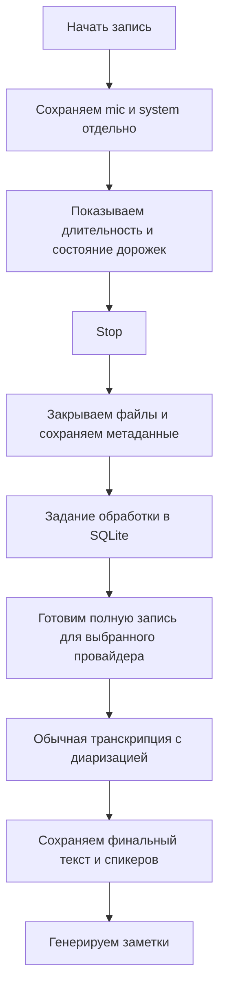

# Запись → Stop → обработка

Решение Тимура от 2026-09-23. Заменяет предложения о транскрипции фрагментов во время встречи и локальном черновике. M1–M4 код этой схемы реализован; focused и интеграционная проверка остаются за root. Live mic/system hardware smoke отложен и остаётся непроверенным.

## Текущая реализация и проверка

- SQLite хранит `meeting_recordings`, `meeting_recording_epochs`, `meeting_processing_runs`, `meeting_deletion_intents` и `meeting_run_speaker_corrections`; managed files содержат source PCM epochs, derived WAV и per-run JSON results. Пути описаны в [architecture.md](architecture.md).
- Config snapshot сохраняется до первого audio frame. Во время capture нет ASR/provider calls. Stop закрывает tracks и создаёт initial run; worker ждёт retention sync, уступает capture и запускает обработку после Stop.
- Один mono WAV следует общей timeline и сохраняет gaps; raw provider JSON сохраняется до normalization. Transcript и summary разделены по runs. Выбор версии обновляет Notes projection, не меняя ручной `note.content`.
- Историческое [chunking research](transcription-chunking-research.md) сохранено как superseded proposal preview/обработки во время встречи; это не текущий pipeline.
- M1, M2 и M3 focused root test gates пройдены. M4 focused tests и итоговая интеграция ожидают root. Live mic/system tail-loss/recovery остаётся непроверенным.

Команды root-owned проверки:

```sh
node --import tsx --test --test-concurrency=1 test/helpers/meetingRecordingRetention.test.js test/services/meetingResults.test.js test/services/uploadNotes.test.js test/helpers/retentionSettings.test.js
pnpm run typecheck
pnpm run lint
pnpm test
pnpm run pack
node scripts/smoke-electron.js
```

После pack для повторных Node SQLite тестов нужен `pnpm --dir node_modules/better-sqlite3 exec prebuild-install`. Hardware smoke — отдельная изолированная macOS arm64 проверка; её нельзя считать выполненной по этому документу.

## Согласованная схема



- Во время встречи выполняются захват, сохранение и контроль состояния. ASR, диаризации, черновика и автоматических заметок нет. Ручные заметки остаются доступны.
- Исходные mic/system записываются один раз. Чанки файлов нужны для сохранности и восстановления, а не для отправки отдельных минут в ASR.
- После Stop закрываем весь хвост и фиксируем завершённую запись. Затем начинается обработка. Без сети запись остаётся в очереди.
- После Stop один derived mono WAV покрывает полную timeline с сохранением gaps и поступает в выбранный существующий ASR route. Внутренние source tracks остаются раздельными; независимые track transcripts не склеиваются.
- Подготовка входа (контейнер, ресемплинг, при необходимости AEC) создаёт производные файлы. Исходники не меняются.
- Ответ провайдера сохраняется до построения заметок. Ошибка заметок не требует повторять ASR. Интегрированную диаризацию нельзя обещать повторять отдельно, если API этого не умеет.
- Спикер A/B — различение голосов. Имена требуют узнавания известного голоса или подтверждения пользователя; календарь не доказывает личность.
- В UI после Stop: «Запись сохранена» → «В очереди / Обработка» → «Готово». При проблеме видно, что сохранено и какой этап требует повтора. Повреждённая или неполная запись не становится незаметно полной после ASR.

## Провайдеры первой реализации

Решение Тимура: сразу включить **ElevenLabs, Deepgram и Gemini** в post-Stop обработку. Это согласованный объём реализации, не список кандидатов для предварительного отбора. Пользователь выбирает провайдера и свои credentials; одна обработка использует выбранного провайдера, без автоматического запуска всех трёх.

Все три адаптера возвращают текст, временные метки и доступную диаризацию в общий формат. Сохраняются исходный ответ, провайдер, модель, настройки и состояние обработки. Из той же сохранённой записи пользователь может запустить новую обработку другим провайдером, сохранив предыдущий результат для сравнения.

Лимиты и поддерживаемые возможности проверяются по контракту API при реализации и явно показываются до отправки неподдерживаемой записи. Ограничение одного провайдера не блокирует остальные; нет молчаливой смены провайдера, обрезания аудио или отключения диаризации.

Гипотезы ниже Тимур проверяет самостоятельно после появления работающей версии. Сравнительный benchmark не является предварительным условием реализации всех трёх адаптеров. Обычные проверки корректности реализации, сохранности аудио и восстановления заданий остаются частью разработки.

## Что перестаёт быть задачей первой версии

- Выбор минутных окон ASR и разрезов по паузам.
- Перекрытия соседних запросов и удаление повторов на стыках.
- Постепенная публикация текста и замена черновика финалом.
- Согласование номеров спикеров между минутными запросами.
- Локальная ASR-модель для preview и её нагрузка во время разговора.

Проблема согласования остаётся, если мы сами разделим длинную запись во времени или независимо обработаем источники с одним голосом в обоих. Не вводить такое деление автоматически.

## Гипотезы для самостоятельной проверки после реализации

Проверки ниже ещё не выполнены. Принцип сохранности исходников — требование, а не гипотеза. Гипотезы касаются способа его реализации и качества обработки.

| Приоритет | Гипотеза | Как проверить | Критерий и влияние на решение |
| --- | --- | --- | --- |
| P0 | Полный derived WAV укладывается в фактические provider limits. | Для ElevenLabs, Deepgram, Gemini и OpenAI проверить запросы на максимальной нужной длительности: входные лимиты, timeouts, полный охват начала/середины/конца. | Provider принимает целевую длительность и возвращает полный результат. Иначе показать capability/limit error; не делать скрытый split, обрезание или fallback. |
| P0 | Mono mix сохраняет нужную речь, перебивания и временные gaps. | На контрольных mic/system записях сравнить derived WAV с отдельными оригиналами; включить наушники, динамики, одновременную речь, несколько людей у микрофона, restart epoch и тишину между репликами. | Проверить пропуски, эхо-дубли, speaker turns и aligned offsets. Это оценка качества выбранного единого входа; не добавлять независимые track transcripts или второй processing path. |
| P0 | Захват и формат хранения позволяют восстановить обе дорожки после сбоя. | Записать тестовый сигнал/речь, выключить сеть, закрыть renderer, аварийно завершить процесс, сменить устройство, выполнить Stop посреди речи, проверить нехватку места и пропавший system source. | Закрытые файлы читаются; последний файл восстанавливается или его потерянный интервал явно отмечен; Stop сохраняет весь полученный хвост; запись не стартует как полная dual-track при недоступном источнике. Измерить и согласовать допустимое окно потери при аварии; выбрать формат и частоту фиксации. |
| P1 | ASR и диаризация достаточно точны на наших русских встречах. | Один и тот же набор записей для всех кандидатов: 1:1, 3+ участников, русский с английскими терминами, имена/числа, короткие ответы, тихая речь, шум. Разметить одинаковые отрывки и speaker turns. | Сравнить WER/ошибки имён и чисел, ошибки назначения слов спикерам и скачки speaker ID. Заранее согласовать допустимое качество; не выбирать по демо или одному чистому отрывку. |
| P1 | Полный проход укладывается в приемлемые время и стоимость после Stop. | Измерить подготовку, upload, ASR/диаризацию и заметки на 30/60/120 мин, плохую сеть и повтор запроса. | Получить фактическую длительность запроса, стоимость встречи и ожидание; затем согласовать бюджет и предел ожидания. |
| P1 | Задание переживает перезапуск и не требует повторного ASR после уже сохранённого ответа. | Прервать finalization, upload, ожидание ответа, локальное сохранение результата и генерацию заметок; перезапустить приложение. | Задание либо восстановлено, либо показывает понятную ошибку. Сохранённый ответ используется повторно, сегменты не дублируются, ошибка summary не запускает ASR. Для неопределённого исхода запроса проверить provider result lookup/idempotency; отсутствие такой функции означает возможную повторную оплату, а не обещание exactly-once. |
| P1 | Синхронизация источников достаточна для воспроизведения, AEC и цитат. | Сравнить начала/концы, контрольные сигналы и интервалы на длинной записи; сменить аудиоустройство, проверить drift и перезапуск источника. | Временные метки соотносятся с исходниками; пропуски не сжимаются. Зафиксировать допустимую погрешность и хранить source epochs/offsets при необходимости. |
| P2 | Итоговые заметки опираются на финальный транскрипт и корректных участников. | Проверить утверждения, решения, числа и ответственных по размеченным отрывкам; отдельно случай неизвестных имён. | Нет выдуманных имён и назначения задач по предположению; ссылки ведут к нужному месту записи. Настройка summary не требует менять захват. |

## Первоначальный порядок работ (M1–M4 реализованы)

1. M1–M4 реализуют capture, storage/recovery, post-Stop processing, выбор результатов, retention, deletion и Notes consumer surfaces.
2. Root выполняет focused/full verification и изолированный hardware smoke; tail-loss остаётся непроверенным до измерения.
3. Тимур оценивает качество, speaker attribution, latency и cost на своих записях. 30/60/120 минут — proposal испытаний, не продуктовый лимит.
4. Лимиты и настройки уточняются по evidence; победитель среди провайдеров не выбран.

В post-Stop реализации используются ElevenLabs, Deepgram, Gemini и OpenAI, а также существующий Local meeting path. OpenAI использует существующий файловый маршрут с `gpt-4o-transcribe-diarize` для speaker segments и сохраняет исходный JSON до нормализации. По документации, проверенной 2026-09-25, [OpenAI](https://platform.openai.com/docs/api-reference/audio/createTranscription) требует `diarized_json` для speaker annotations и `chunking_strategy` для записей длиннее 30 секунд. [Gemini](https://ai.google.dev/gemini-api/docs/transcribe) ограничивает вход с diarization/timestamps 30 минутами; для более длинной записи это должно отображаться как ограничение route. [ElevenLabs](https://elevenlabs.io/docs/overview/capabilities/speech-to-text) описывает стандартный режим до 10 часов; [Deepgram](https://developers.deepgram.com/docs/pre-recorded-audio) — лимит размера файла и времени обработки. Это проверка документации, не тест качества, скорости или полноты результата. Отдельные исходные tracks сохраняются; текущий processing использует один derived mono WAV.

Источники и прежние альтернативы сохранены в [исследовании репозиториев](transcription-chunking-research.md); предложения о preview и обработке во время встречи там имеют исторический статус.
